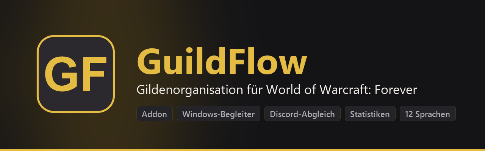
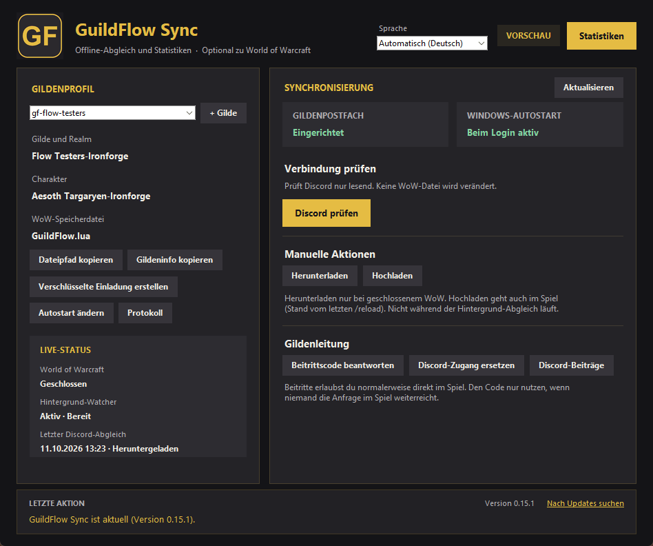
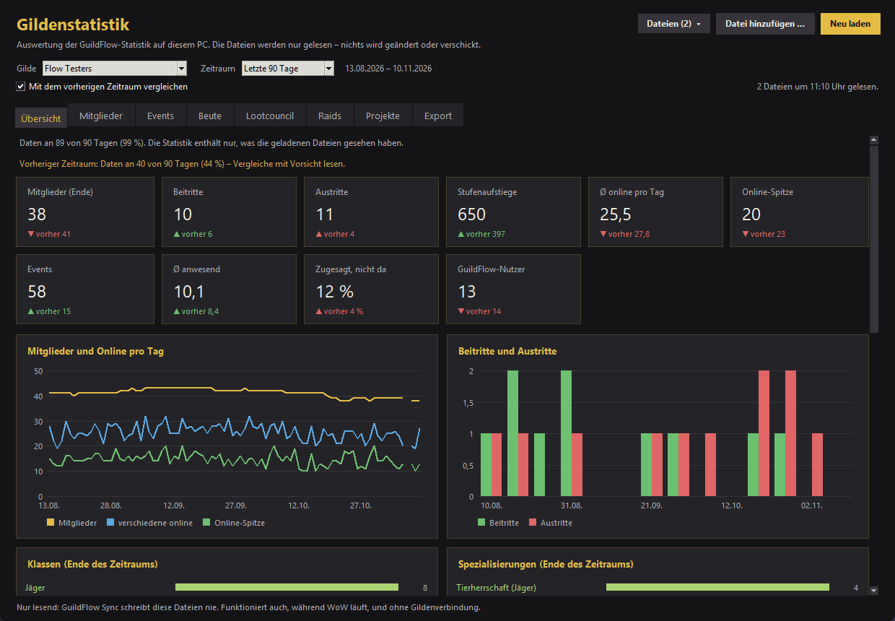
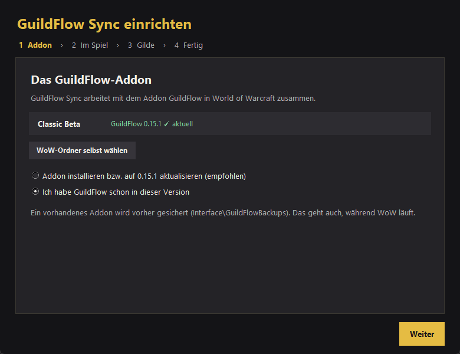
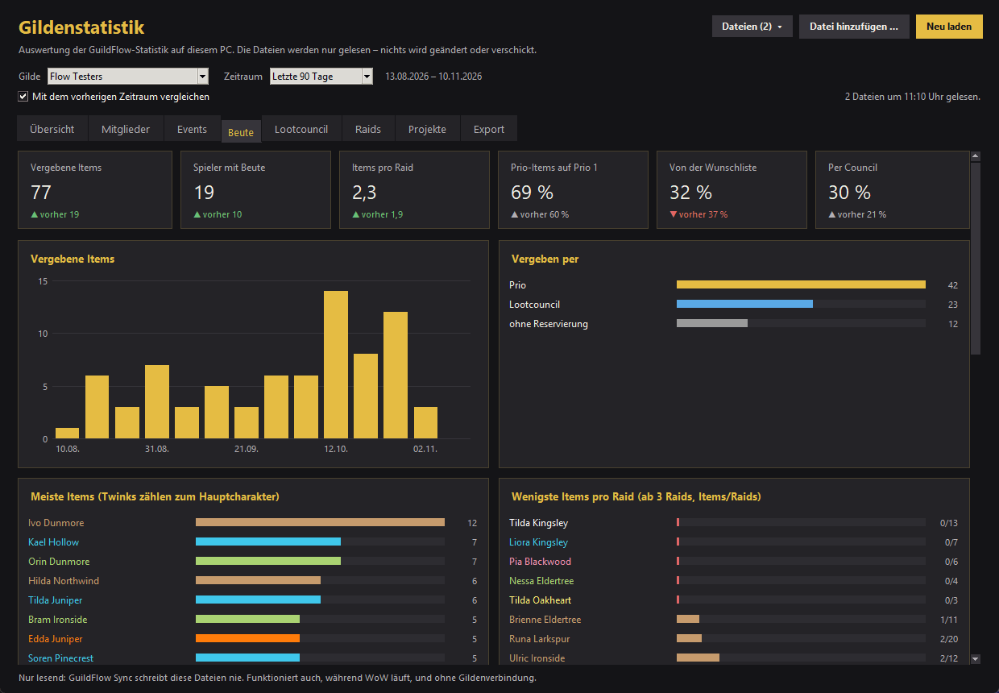
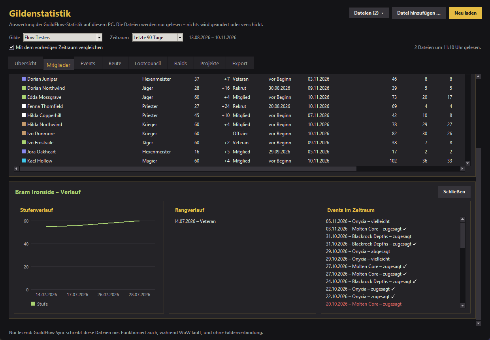
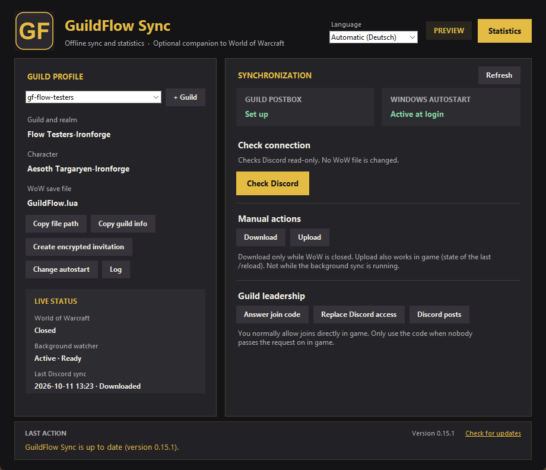
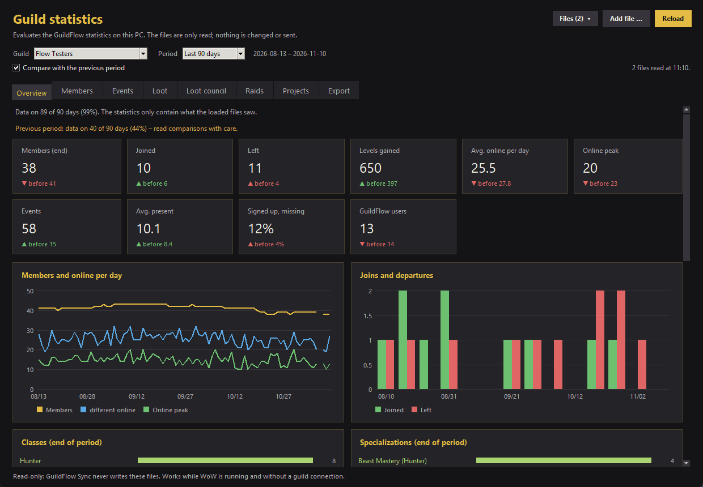

  

  
  
  
  

  
   
  Programm und Addon in einem Setup · aktualisiert sich selbst ·
  <a href="https://github.com/derjp87/GuildFlow-Releases/releases/latest/download/GuildFlow.zip">nur das Addon (ZIP)</a> ·
  <a href="#english">English</a>

---

## Was ist GuildFlow?

**GuildFlow** ist ein Gilden-Addon für *World of Warcraft: Forever*: Events und Raids mit Anmeldungen, Beute und
Lootcouncil, Berufe, Gildenprojekte, Statistiken – direkt im Spiel, ohne Server und ohne Konto.

**GuildFlow Sync** ist das optionale Windows-Programm dazu. Es gleicht die Gildendaten über einen Discord-Kanal
eurer Gilde ab, damit Events, Anmeldungen und Profile auch dann ankommen, wenn ihr nie gleichzeitig online seid.

<table>
  <tr>
    <th width="50%">Im Spiel (Addon)</th>
    <th width="50%">Auf dem PC (GuildFlow Sync)</th>
  </tr>
  <tr valign="top">
    <td>
      <ul>
        <li>Eigener Kalender mit Raidtagen, Anmeldungen nach Rolle und Spezialisierung, Warteliste, Erinnerungen</li>
        <li>Raidaufstellung mit Buff-Übersicht, Boss-Kills und Raidfortschritt</li>
        <li>Soft-Reserves mit Prioritäten und ein Lootcouncil mit Wunschlisten</li>
        <li>Spezialisierungen aus den Talenten (auch Dualspec), Talente jedes Mitglieds im Profil</li>
        <li>„Wer kann das herstellen?“, Gildenprojekte, Fortschritt, Tickets an die Gildenleitung</li>
        <li>Gildenstatistik direkt im Spiel</li>
      </ul>
    </td>
    <td>
      <ul>
        <li>Einrichtungsassistent: Addon installieren, Gilde beitreten oder einrichten</li>
        <li>Offline-Abgleich über Discord – nach jedem <code>/reload</code> und nach dem Spielen</li>
        <li>Lesbare Discord-Beiträge: Events mit Anmeldungen, Ergebnisse mit Bossen und Beute, Wochenrückblick</li>
        <li>Ausführliche Gildenstatistik mit Diagrammen, Vergleich und CSV-Export</li>
        <li>Mehrere Gilden auf einem PC, läuft unsichtbar im Hintergrund (GF-Symbol neben der Uhr)</li>
        <li>Aktualisiert sich selbst – Programm und Addon</li>
      </ul>
    </td>
  </tr>
</table>

  
  

Alle Bilder zeigen eine erfundene Testgilde.

## Installation in vier Schritten

**Du brauchst:** Windows 10 oder 11, World of Warcraft: Forever und – für den Offline-Abgleich – den Discord-Server
deiner Gilde.

1. **Herunterladen und starten:**
   [GuildFlowSync-Setup.exe](https://github.com/derjp87/GuildFlow-Releases/releases/latest/download/GuildFlowSync-Setup.exe).
   Das Setup braucht keine Administratorrechte. Windows warnt beim ersten Mal, weil das Setup noch nicht digital
   signiert ist: **„Weitere Informationen“ → „Trotzdem ausführen“**.
2. **Addon:** Der Assistent zeigt deine WoW-Versionen und installiert oder aktualisiert GuildFlow. Ein vorhandenes
   Addon wird vorher gesichert.
3. **Im Spiel:** Einloggen, ein paar Sekunden warten und `/reload` eingeben. War das Addon neu, starte WoW einmal
   ganz neu. Der Assistent erkennt deinen Charakter von selbst.
4. **Gilde:**
   - **Beitreten** – wenn deine Gilde GuildFlow Sync schon nutzt: Du schickst eine Anfrage, ein Offizier erlaubt sie
     im Spiel (oder lässt Anfragen automatisch erlauben), und du fügst den Einladungslink aus dem Discord-Kanal ein.
   - **Einrichten** – für Gildenleitung und Offiziere: zwei Discord-Webhooks anlegen (Sync-Kanal und lesbarer
     Kanal), der Assistent erklärt jeden Schritt.

  

### Nur das Addon

Ohne Windows-Programm (z. B. auf dem Mac): [GuildFlow.zip](https://github.com/derjp87/GuildFlow-Releases/releases/latest/download/GuildFlow.zip)
herunterladen und den Ordner `GuildFlow` nach `Interface\AddOns` deiner WoW-Version entpacken. WoW neu starten,
dann `/gf` oder der Reiter **GuildFlow** im Gildenfenster (J).

## Updates

GuildFlow Sync sucht alle paar Stunden nach einer neuen Version, solange WoW geschlossen ist, und beim Öffnen des
Hauptfensters – unten rechts gibt es **„Nach Updates suchen“**. Installiert wird nur, was mit dem Release-Schlüssel
von GuildFlow signiert ist und dessen Prüfsumme stimmt. Das Addon wird dabei mit aktualisiert.

## Gildenstatistik

  
  

Übersicht, Mitglieder (mit Verlauf jedes Mitglieds), Events, Beute, Lootcouncil, Raids und Projekte – über 7 Tage
bis zum ganzen Archiv, im Vergleich zum vorherigen Zeitraum. Die Statistik liest nur die Dateien auf deinem PC,
auch während WoW läuft, und braucht keine Gildenverbindung.

## Sicherheit und Datenschutz

- **Kein Server:** Das Addon nutzt Blizzards Addon-Nachrichten im Gildenkanal. Der Offline-Abgleich läuft
  ausschließlich über den Discord-Kanal eurer Gilde.
- **Zugangsdaten bleiben auf deinem PC:** Discord-Webhooks liegen verschlüsselt im Windows-Benutzerkonto (DPAPI).
  Gib Webhook-Adressen, Einladungslinks und Dateien aus `%LOCALAPPDATA%\GuildFlowSync` nie weiter.
- **Privates bleibt privat:** Tickets und Notizen zu Probemitgliedern gehen nur per direkter Flüsternachricht an die
  Berechtigten und nie über Discord.
- **Geprüfte Updates:** Jede Version ist signiert (Ed25519). Selbst prüfen kannst du die Prüfsumme in PowerShell mit
  `Get-FileHash .\GuildFlowSync-Setup.exe` und mit `SHA256SUMS` im Release vergleichen.

## Häufige Fragen

<b>Windows oder der Virenscanner warnt vor dem Setup</b>

Das Setup ist noch nicht digital signiert (Code-Signing), daher kennt Windows SmartScreen den Herausgeber nicht:
„Weitere Informationen“ → „Trotzdem ausführen“. Programme, die mit PyInstaller gebaut sind, werden von manchen
Virenscannern fälschlich gemeldet. Prüfe im Zweifel die Prüfsumme (siehe oben).

<b>Das Addon erscheint im Spiel nicht</b>

Nach einer Neuinstallation WoW einmal komplett beenden und neu starten – `/reload` reicht dafür nicht. Der Ordner
muss genau `Interface\AddOns\GuildFlow` heißen. In der Addon-Liste im Charakterauswahl-Bildschirm muss GuildFlow
aktiviert sein.

<b>„World of Warcraft läuft“ – warum soll ich WoW schließen?</b>

WoW überschreibt seine Speicherdateien beim Beenden. Deshalb ändert GuildFlow Sync sie nur, wenn WoW geschlossen
ist. Hochladen klappt auch während des Spielens: Nach jedem `/reload` geht der aktuelle Stand raus.

<b>Ich spiele mehrere Charaktere in verschiedenen Gilden</b>

Kein Problem: Jede Gilde bekommt ein eigenes Profil, ein Hintergrund-Abgleich kümmert sich um alle Gilden einer
WoW-Installation.

<b>Wie entferne ich GuildFlow wieder?</b>

Windows-Einstellungen → Apps → **GuildFlow Sync** deinstallieren. Das Addon entfernst du, indem du den Ordner
`Interface\AddOns\GuildFlow` löschst.

---

## English

**GuildFlow** is a guild addon for *World of Warcraft: Forever* – calendar and raids with sign-ups by role and
specialization, soft reserves and a loot council, professions, guild projects and statistics, right in the game.
**GuildFlow Sync** is the optional Windows program: it syncs the guild through your guild's Discord channel (so
events, sign-ups and profiles arrive even if you are never online at the same time), writes readable Discord posts,
shows detailed guild statistics and keeps itself and the addon up to date. Both speak 12 languages.

  
  

**Install:** download
[GuildFlowSync-Setup.exe](https://github.com/derjp87/GuildFlow-Releases/releases/latest/download/GuildFlowSync-Setup.exe)
(Windows 10/11, no admin rights needed). SmartScreen warns because the setup is not code-signed yet: "More info" →
"Run anyway". The setup wizard installs the addon, asks you to log in and `/reload`, then lets you **join** your
guild (an officer allows the request in game, you paste the invite link from Discord) or **set it up** (officers:
two Discord webhooks).

**Addon only:** unzip [GuildFlow.zip](https://github.com/derjp87/GuildFlow-Releases/releases/latest/download/GuildFlow.zip)
into `Interface\AddOns` and restart WoW; open it with `/gf`.

**Updates** are automatic while WoW is closed, signed (Ed25519) and checksum-verified; "Check for updates" is at the
bottom right of the main window.

**Privacy:** no server – addon messages in the guild channel and your guild's Discord channel only. Discord webhooks
stay encrypted in your Windows account (DPAPI); never share webhook addresses, invite links or files from
`%LOCALAPPDATA%\GuildFlowSync`.

---

  <a href="https://github.com/derjp87/GuildFlow-Releases/releases">Alle Versionen und Änderungen · All versions and changes</a>
  · Screenshots zeigen eine erfundene Testgilde · Screenshots show a fictional test guild

